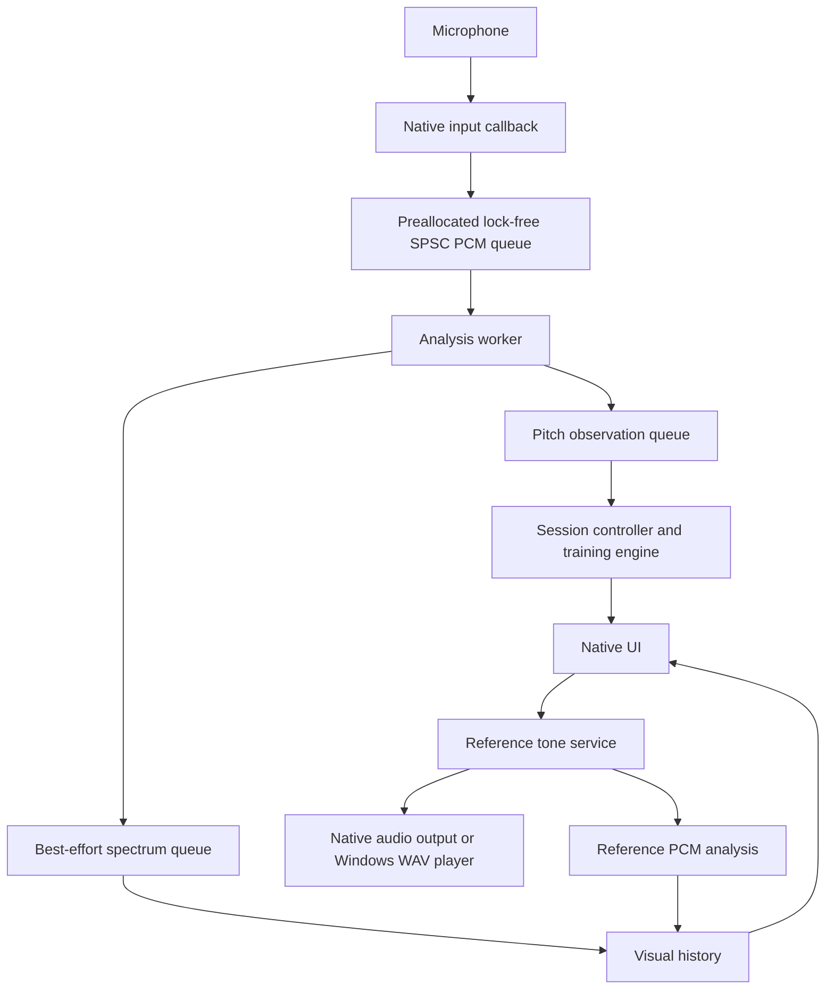

# SingCoach — complete overview for a rebuild

Prepared 2026-10-15 from the current source, product instructions and session
history. This document is intended to stand on its own when starting a new repo.
It describes the existing product, explains implementation choices, and explicitly
labels recommendations for the rebuild. It does not require reproducing every
prototype feature or its internal structure.

## 1. What the app does

### Purpose and audience

SingCoach is a personal desktop singing trainer for one user. It provides a
reference pitch, listens to the microphone, measures the user's pitch behavior,
and turns that measurement into one specific instruction for the next repetition.

The motivating pattern is an inconsistent start or note change followed by a
comparatively stable held pitch. Training therefore prioritizes:

1. Starting a note directly, without an unintended scoop or fall.
2. Moving cleanly between two notes while keeping the sound continuous.
3. Repeating good attempts reliably, rather than occasionally achieving a high score.

Sustained stability is measured, but it should not dominate training while attacks
and transitions are weaker. Phrasing and melody memory are secondary priorities.

The essential interaction is:

```text
Choose a target → hear a beep → sing → pause → read one correction
                                           ↓
                                   repeat until 5 scored attempts
                                           ↓
                                   assess consistency → new drill
```

### Product principles

| Principle | Consequence for behavior |
| --- | --- |
| Personal and small | No accounts or online service are needed to practice. |
| Train the weakest skill | Prefer short targeted drills over broad song scoring. |
| One correction at a time | Show the most useful next action, with measurements available underneath. |
| Evidence before judgment | Unclear, clipped or interrupted audio may receive no score. |
| Technique and style differ | Technique drills reward direct starts; performance mode permits slides. |
| Reliability matters | Show spread, worst attempt and clean-hit ratio alongside the mean. |
| Keep sound simple | Reference output is a pure electronic beep; no artificial singer or synthesized ‘ah’ voice. |

The user may sing an ‘ah’ vowel as an exercise instruction. That does not imply
the app should synthesize a human vowel. Voice synthesis was explicitly removed
at the user's request.

### Current feature inventory

| Feature | Current behavior | Rebuild priority |
| --- | --- | --- |
| Microphone control | Automatic input startup, device selection, refresh, stop/start | Essential |
| Live pitch monitor | Note name, Hz, cents from target and periodicity | Essential |
| Audible reference | Single-note beep, continuous held beep and connected two-note example | Essential |
| Clean attack drill | Target selection, technique/performance modes, per-attempt feedback | Essential |
| Five-attempt summary | Mean, spread, best/worst, clean ratio and reliability | Essential |
| Two-note transition drill | Up/down intervals with continuous-voice analysis | Next after attack loop works |
| Find my range | Guided matched-note search with a suggested starting note | Useful, separate workflow |
| Full-scale pitch view | C2–C6 overview | Useful |
| Spectrogram | Compare reference and microphone frequency content | Optional diagnostic view |
| Session review | Review previous voice data and reference guides | Optional initially |
| Persistent learning history | Not implemented | Deferred |
| Adaptive mastery/curriculum | Described in original plans, not implemented | Deferred |

### A. Clean attack training

The user chooses a target note, hears a one-second beep, sings approximately one
second, and leaves a short quiet pause. The app segments an attempt automatically.
It reports:

- Initial pitch error in cents, including whether the start was low or high.
- Time until the pitch first establishes a sustained match to the target.
- Pitch center after settling.
- Spread of sustained pitch.
- Mean periodicity and whether the measurement can be scored.
- One coaching instruction and an attempt score.

For example: “You started 42 cents low. Try to enter directly on the note.”
After a clean entry: “Clean attack. Repeat it reliably.”

Technique mode rewards direct entry and fast settling. Performance mode permits
a scoop and checks target arrival; the current performance score is only binary
arrival/no arrival. It does not assess expression, musical phrasing or song quality.

### B. Note transition training

The user chooses a first note and an interval: +2, +5, +7, −2, −5 or −7 semitones.
The example holds each pitch for about 0.8 seconds. The user sings one connected
vowel through both notes, then pauses.

The app checks a clear first hold, detects departure from that pitch, finds
confirmed arrival at the second pitch and measures the movement between them.
It reports starting pitch error, transition duration, arrival pitch error and
arrival spread. An interrupted or unclear transition can abstain.

The green target guide changes at 0.8 seconds of the attempt. Scoring measures
the observed departure and arrival rather than requiring that exact cue time.
Current transition scoring is technique-only; it ignores the shared Mode value,
and the UI hides the mode selector for this module. A performance transition
mode would be new work, not existing behavior.

### C. Find my range

This explores notes the user can match in their relaxed usual voice. It does not
determine absolute vocal limits, physiological comfort, voice type or register.

1. Start at C3, or the previously accepted starting note from this session.
2. Play a continuous beep while the user searches for the pitch.
3. Before the first match, a clear stable voice held for roughly 1.5 seconds may
   move the baseline toward the pitch the user is actually singing. Lower/Higher
   controls also allow baseline adjustment.
4. Require a continuous one-second match; searching and uncertain pitch do not
   count toward the hold bar. No pause is required between matched targets.
5. After the first match, rise in two-semitone steps.
6. When the user chooses “Feels strained / can't reach,” start exploring below
   the first matched note, without repeating the climb.
7. The same button ends the lower search. C2–C6 are the prototype's search bounds.
8. Show the lowest/highest matched notes and recommend a matched note near the
   span's midpoint. Completion currently applies the result automatically.

Silence does not establish a limit. One matched note is an incomplete range.
Headphones matter because speaker leakage can be mistaken for a sung match.
The workflow pauses exercise scoring and contributes no drill attempts.

### D. Visual exploration and review

The user can watch a live pitch trace, switch to a full-scale chart, or inspect a
spectrogram. Microphone data and generated-reference data remain distinct.
Reference visuals are analyzed from prepared PCM, so they work with headphones
or a stopped microphone; they are never evidence that the user sang correctly.

Charts and saved reference guides survive drill resets and exercise changes.
Stopping capture freezes the voice display for review. A history slider moves
through this session; saved guide thumbnails select earlier examples. Nothing
is persisted across closing the app in the current implementation.

## 2. Architecture

### Existing stack and modules

The main app uses Rust 2021, CPAL 0.15.3 for native audio, ringbuf 0.4.8 for SPSC
queues, and egui/eframe 0.31.1 for the desktop UI. Versions are pinned and
Cargo.lock exists. DSP is implemented in Rust, with no Python in the audio path.

| Module | Responsibilities |
| --- | --- |
| `apps/desktop` | Window startup, app construction and playback-only diagnostic option |
| `singcoach-core` | Pitch math, note names and shared pitch/spectrum observations |
| `singcoach-audio` | Input devices, capture, callback queues, analysis worker lifecycle, reference output and errors |
| `singcoach-dsp` | Pitch detector interface, custom YIN estimator and spectral measurements |
| `singcoach-training` | Segmentation, validity gates, attack/transition scoring, five-attempt summary and range search |
| `singcoach-ui` | Controls, rendering, session history and coordination of exercise/range/playback workflows |
| Windows WAV helper | A small C# SoundPlayer executable used by the latest WSL output route |

The helper is a platform workaround, not part of training or pitch analysis.
Its latest version has not yet been confirmed audible on the user's machine.

### Data flow and thread boundaries



In the current prototype the training logic is offline-callable, but the UI
invokes it and owns much of the workflow state. The rebuild recommendation is
to move that coordination into a session controller independent of the view.

**Input callback:** convert supported PCM types to float, average channels into
mono, push samples into a preallocated SPSC buffer and set atomic error counters.
Do not allocate, lock, touch files/network, log, render UI or run analysis there.

**Analysis worker:** pull samples, build overlapping windows, estimate pitch and
periodicity, measure RMS/clipping, calculate spectra and publish observations.
The worker may allocate outside the callback, but steady-state work should be
measured before optimization. Scoring observations must not silently disappear.

**Session/training controller:** decide which workflow is active, gate scoring,
segment activity, evaluate completed attempts, collect five valid results and
select one correction. Range search is a distinct workflow.

**UI thread:** render state and submit user commands. It should not need to know
how the platform plays WAVs or how YIN estimates a period.

### Current capture and DSP parameters

| Parameter | Current value or behavior |
| --- | --- |
| Default target | C3, MIDI 48, approximately 130.81 Hz |
| Selectable note bounds | C2–C6, MIDI 36–84 |
| Input SPSC capacity | Approximately half a second of mono samples |
| Analysis window | 50 ms |
| Observation hop | Approximately 10 ms |
| Pitch detector | Custom YIN with interpolated period estimate |
| Pitch search range | Approximately 65–1100 Hz |
| Quiet/activity threshold | RMS 0.008 in normalized PCM |
| Clipping threshold | Any analysis sample magnitude ≥0.995 |
| Usual periodicity gate | 0.85 |
| Pitch observation queue | 256 frames; send failure marks capture failed |
| Spectrum queue | 128 frames; display frames may drop without stopping scoring |
| Spectrum | 192 logarithmic frequency measurements, 65–4000 Hz, Hann window, floor −120 dBFS |

YIN periodicity is a heuristic, not the probability that the note is correct.
An octave error may be highly periodic. Spectrogram harmonics are not separate
sung notes. Display gain changes visibility, not input audio or scoring.

Timestamps refer to analysis-window starts in captured sample time. Capture and
reference timelines are mapped to session time for display. Overlapping windows
blur onset/arrival timing; a 10 ms update interval is not 10 ms timing accuracy.

### Measurement and scoring definitions

Pitch relationships:

```text
Hz = 440 × 2^((MIDI − 69) / 12)
MIDI = 69 + 12 × log2(Hz / 440)
cents error = 1200 × log2(measured Hz / target Hz)
```

Positive cents means above the target; negative means below. One semitone is
100 cents. Invalid or unvoiced pitch is represented explicitly, not as 0 Hz.

**Attempt segmentation:** acoustic activity begins the segment, including an
uncertain onset. End it after 200 ms quiet; preserve shorter gaps so settling
cannot bridge a silent interruption. After more than 1,500 observation frames,
discard the long attempt and wait for silence before restarting. Instructions
ask the user for at least a 250 ms pause, giving margin beyond segmentation.

**Attack validity:** at least 350 ms total, at least 80% valid pitch observations,
clear early frames, no clipping and strictly increasing timestamps without gaps
over 25 ms. Abstention leaves the attempt outside the five-result summary.

**Attack measurements:** initial error is the median of valid observations
through the first 30 ms. Settling is the beginning of the first continuous
100 ms run within ±15 cents. Sustain center and population spread use valid
observations from settling onward. A clean technique attack starts within
±20 cents, settles within 80 ms and has a sustain median within ±15 cents.

```text
Technique score = clamp(
    100 − 0.6 × |initial cents|
        − 0.15 × settling milliseconds
        − 0.4 × |settled median cents|,
    0, 100
)
```

An unsettled attempt uses a 1,000 ms timing penalty. Performance attack score
is 100 for confirmed target arrival or 0 otherwise.

**Transition validity:** at least 800 ms total, at least 90% valid frames, no
clipping/discontinuity and a clear first 250 ms. The initial hold must remain
within ±35 cents; a confidently wrong first note receives corrective feedback.
Departure leaves ±40 cents of the first note, after the initial hold. Arrival
establishes 100 ms within ±15 cents of the destination. Broken voicing during
movement prevents a reliable continuous-transition measurement.

Clean transition requires movement ≤80 ms, destination median within ±15 cents
and destination spread ≤20 cents. Current score is clamped to 0–100:

```text
100 − 0.15 × transition milliseconds
    − 0.4 × |destination median cents|
    − 0.5 × max(destination spread − 20, 0)
```

**Consistency:** exactly five scored attempts produce mean, population SD,
best/worst, clean-hit proportion and `clamp(mean − SD, 0, 100)` reliability.
Do not compare scores across exercises or modes as if they were equivalent.

These are prototype heuristics, not validated physiological measurements or
mandatory formulas for a new implementation. Preserve explainability and
abstention; validate thresholds using real singing before treating them as truth.

### Reference sound and platform output

The reference is a steady sine beep. Single examples last one second with a
30 ms rounded attack, 120 ms release and 150 ms silent tail. Connected examples
hold each note about 800 ms. Native held output changes frequency with a short
smooth slew and stops with a fade. Continuous Windows references use seamless
integer-cycle WAV loops with negligible pitch rounding.

The latest WSL route launches a compiled C# SoundPlayer helper, sends WAV paths
as data over stdin, and receives READY/DONE messages. One process owns playback
during a range check. `run.sh` builds the helper once using the Windows .NET
Framework compiler and reuses it. Other native environments use CPAL output.

Important history for a rebuild:

- Linux/WSLg output previously developed a squishy sound even when generated
  WAVs and Linux output-monitor recordings were clean.
- Windows-direct output was confirmed clean earlier by the user.
- More recently PowerShell stopped starting: a trivial output command timed out
  independently of the app, while CMD worked. It has now been removed from
  playback. The replacement helper still awaits Windows compilation/listening
  confirmation; passing Rust tests does not validate that helper.
- Preserve explicit Windows routing under WSL unless the user deliberately
  changes the requirement. Do not silently fall back to the known bad route.
- For a fresh Windows-native app, direct native input/output avoids this WSL
  bridge and helper. That is a rebuild architecture option, not a measured fix.

Reference charts use prepared PCM. READY or callback sample counts coordinate
their progress; neither provides calibrated sound-at-headphones timing. Ordinary
drill scoring pauses during output, waits through a 500 ms cooldown, then needs
250 ms observed quiet. Microphone capture and charts continue independently.
Range matching intentionally occurs while a reference plays.

### Data ownership and rebuild interfaces

Existing data is session-only: pitch/spectrum histories, reference guide records,
current target/mode, latest result, up to five scored results and matched range.
No microphone recordings are saved or transmitted. Temporary reference WAVs and
player logs are saved for diagnostics. These are generated output, not voice.

Recommended boundaries for the rebuild:

| Interface/model | Minimum responsibility |
| --- | --- |
| `AudioInput` | Devices, start/stop, samples and stream errors |
| `PitchDetector` | PCM window → optional pitch, periodicity, level and clipping |
| `ReferencePlayer` | Play once, hold, retune, stop, ready/completed/failed |
| `AttemptSegmenter` | Ordered observations → completed segment or discard |
| `ExerciseEvaluator` | Segment + typed exercise config → measured result or abstention |
| `DrillSession` | Current config, workflow state, latest feedback, five valid results |
| `RangeSession` | Baseline, requested note, hold progress, matched notes and completion |
| `SessionHistory` | Voice and reference observations with explicit source/timing |
| `ViewModel` | Read-only presentation state and supported user actions |

Use results specific to attacks/transitions rather than reusing attack-named
fields for every exercise. Separate `Measured` from `Unscored(reason)`; a genuine
measured miss differs from missing evidence. Keep thresholds in named config.

Recommended workflow states, rather than many overlapping booleans:

```text
Drill: Ready → ReferencePlaying → Cooldown → AwaitQuiet → Listening
          ↑                                               ↓
          └──────── Feedback ← Evaluating ← AttemptEnded ──┘
                          ↓ after 5 measured results
                       Complete

Range: FindingBaseline → ExploringHigher → ExploringLower → Complete
       Any active state → Cancelled or Playback/CaptureError
```

The rebuild must block range progression if the current reference is missing or
failed. The prototype only checks readiness when an example object exists, so
it can incorrectly continue after playback failure. Do not reproduce that gap.
Define manual target practice without playback separately if it is desired.

## 3. Layout and interaction design

### Current desktop structure

One dark desktop window; no multi-page navigation is required. Default size is
960×760 with a minimum of 720×640. Header and status are fixed above a vertically
scrollable monitor/exercise area. The monitor adapts to available height; there
is no draggable split divider.

```text
┌─────────────────────────────────────────────────────────────────────┐
│ SingCoach                                                Settings ⚙ │
├─────────────────────────────────────────────────────────────────────┤
│ [Find my range]  Lowest/Highest · Starting note  [Mic ■] ● Listening  │
│ Detected note     On/above/below target     Hz · cents · periodicity │
│ Capture/playback errors when relevant                               │
├─────────────────────────────────────────────────────────────────────┤
│ Monitor: [Compact] [Full scale] [Spectrogram]                        │
│ [Seconds back ───────────────────────────────] [Latest]             │
│ Saved guides: [C3 preview] [D3 preview] [E3 preview] ...             │
│                                                                     │
│                  Live voice and reference monitor                   │
│                                                                     │
├─────────────────────────────────┬───────────────────────────────────┤
│ Exercise setup                  │ Feedback and measurements         │
│ [Exercise dropdown]             │ One primary correction            │
│ Instructions + example [▶ / ■]   │ Initial/starting error            │
│ [Target] [Mode or interval]      │ Settling/transition time          │
│ Criteria and current turn       │ Settled/arrival error             │
│ Attempts: ● ● ○ ○ ○ [New drill]  │ Sustain/arrival spread            │
│                                 │ Score and periodicity             │
│                                 │ Five-attempt reliability summary  │
└─────────────────────────────────┴───────────────────────────────────┘
```

During range checking, the status area shows the active target, a one-second
hold progress bar and baseline/limit controls. The exercise area is paused.
When the exercise area's available width is below 680 px, setup and feedback
stack vertically. Spectrogram reference and voice currently remain side by side;
a rebuild should explicitly decide their narrow-window behavior.

### Status and controls

- App name at upper left; Settings gear at upper right.
- Find my range button becomes Stop range check during the workflow.
- Accepted range shows lowest/highest matched notes and exercise starting note.
- Microphone start/stop button, status dot and explicit Listening/Stopped text.
- Detected note prominently, with on-target/above/below cue and numerical details.
- Use a dash for unavailable values. Never display a fabricated valid note.
- Space toggles capture when no control owns keyboard input; key repeats should
  not repeatedly toggle. Monitor tabs support left/right arrow navigation.

### Monitor views

**Compact:** a three-second musical-pitch view with rows around the target,
voice and reference. Distant unused note ranges can be collapsed with a gap
label. This saves vertical space but makes distance less obvious; provide hover
information. Green is the target, blue the microphone and purple the reference.

**Full scale:** the same sources on a consistent C2–C6 semitone axis. Labels
adapt to size, retaining useful octave/target/voice labels. Useful for larger
intervals, octave confusion and range checking.

**Spectrogram:** pinned example on the left, voice on the right, using matching
frequency scale and display gain. Higher frequencies appear higher; brightness
represents spectral amplitude. Defaults: one-second view, 65–2000 Hz, +12 dB
display gain. Zoom controls allow 0.25–3 seconds, frequency bounds within
65–4000 Hz and gain 0–30 dB. Hover shows time/frequency/level.

Reference examples remain pinned for comparison. Previous/current reference
guides can appear in sequence with waiting gaps omitted. Source timestamps stay
unchanged. Never draw a continuous line across unrelated clips or silent gaps.
Reviewing a reference must not change the target, audio, drill or voice history.

### Exercise and feedback area

Setup contains exercise selector, short instructions, reference play/stop,
target, mode or interval, visible success criteria, progress and New drill.
Feedback contains one correction, optional measurements and the completed
five-attempt summary. An abstention must be visibly different from a low score.

Use exercise-specific labels: “Transition time” is clearer than showing that
value as “Settling time.” The current fixed subtitle “Start directly on one
note” appears even for transitions; a rebuild should derive it from the module.

### Settings and diagnostics

Settings is a small top-right anchored window with input selection, refresh/use
system default, and current output-route description. Linux input selection
prefers desktop-routed PipeWire/PulseAudio inputs, with opening-error fallback.
Silence must never trigger automatic device switching.

The prototype exposes temporary WAV paths under status. Rebuild recommendation:
keep diagnostic paths/logs in a diagnostics view, leaving ordinary practice
focused on actionable status. Show errors where they affect the task, not only
inside developer logs. Ensure keyboard focus and text labels accompany icons
and color cues. Targets, examples and failure messages must fit the minimum size.

## 4. Use cases and expected outcomes

### UC1 — Start a practice session

User launches the app. It opens the default microphone and shows C3 with an
empty drill. Voice activity produces a live trace and valid note readout. If no
input can open, show an actionable error and allow selection/refresh; the app
remains responsive. Successful startup does not require an account or network.

### UC2 — Correct an attack that starts low

User chooses an easy note, plays its beep and sings five short repetitions.
An attempt begins below the target and settles later. Show the measured initial
error and one direct-entry correction. Repetition progress advances only if the
attempt was reliably measured. A better next attempt should improve the relevant
measurements, even before the user gets a perfect score.

### UC3 — Separate intentional style from technique

User deliberately scoops into the target. Technique mode identifies that as
deviation from the drill. Performance mode permits it and checks confirmed
arrival. Changing mode begins a new comparison group so unlike scoring rules
do not enter one five-attempt summary.

### UC4 — Improve an interval transition

User selects C3 → D3 or another supported interval, listens, sings one connected
sound and pauses. A direct change should measure shorter movement than a long
searching glide. A break in voice must not be mislabeled a clean connected
transition. Clearly wrong notes and insufficient evidence need different feedback.

### UC5 — Explore a usable matched range

User starts Find my range with headphones. They match the continuous guide,
advance upward, report strain, explore downward and finish. Display matched
bounds and a middle starting note. Do not require silence between matches or
interpret silence as a physiological limit. Cancel returns to the prior drill;
completion applies the suggested target and starts a new drill in the prototype.

### UC6 — Measure repeatability

User completes five scored attempts. The app reports typical score and spread,
including best/worst and clean-hit ratio. For a concrete example, scores
100, 100, 100, 100, 100 have reliability 100; scores 100, 100, 100, 100, 0 have
mean 80, population SD 40 and reliability 40. A strong best attempt alone is
therefore insufficient evidence of mastery.

### UC7 — Handle unclear input fairly

Noise, low periodicity, clipping, a short attempt or missing observations prevents
trustworthy analysis. Show “Not scored” and a useful retry instruction, retain
the result for explanation, and leave the five-attempt count unchanged. A restart
must be required after capture discontinuity rather than scoring corrupted data.

### UC8 — Compare a voice against the guide

User plays an example while watching reference and voice data. Reference data
comes from prepared PCM, not microphone pickup. During an ordinary drill,
playback and its tail must not create a scored attempt. During a range check,
matching is intentional and headphone use is important. Reference observations
must never enter user measurements.

### UC9 — Stop and inspect a session

User stops capture, reviews earlier pitch/spectral frames and selects a saved
guide. History remains intact. Returning to Latest resumes viewing current data;
starting capture resumes listening. Chart selection must not change the exercise
target or scores. The current prototype loses this history on app exit.

### UC10 — Change configuration without mixing results

User changes target, mode, interval or exercise, or presses New drill. Reset the
current segment, latest feedback and five-attempt list; preserve session charts.
Stop an obsolete reference and wait for quiet before accepting a fresh attempt.
Incompatible transition targets must stay inside the permitted note bounds.

### UC11 — Recover from reference output failure

User requests an example or range check but output cannot start. Show the error,
allow replay/retry and preserve microphone/history. Range matching must wait for
the current target's ready reference. Do not silently choose a known distorted
output path or pretend that a request means the sound is audible. Diagnostic
playback-only mode should isolate output without starting/enumerating inputs.

### UC12 — Switch microphone

User selects another input, or refreshes the system default. Dispose of the old
capture, discard its partial segment and restart if previously listening. Keep
history and session time coherent. A disconnected device yields a clear error;
quiet input remains on the selected device instead of triggering fallback.

## 5. What to carry into the rebuild

### Keep

- A simple audible beep with reliable start/stop, before any visual polish.
- Minimal real-time capture and a separate analysis worker.
- Explicit validity and abstention, with offline-callable evaluators.
- Short attack/transition drills and one instruction per attempt.
- Five-attempt reliability rather than a prominent personal-best score.
- Separate microphone/reference data and technique/performance rules.
- A single understandable window and a small amount of configuration.

### Simplify or redesign

- Choose the actual deployment platform first. The user's current setup is WSL;
  a Windows-native rebuild could use one native input/output stack instead.
- Put workflow state in a controller with explicit states, outside rendering.
- Begin with compact pitch visualization; add spectral review only after the
  core drill is reliable.
- Bound or deliberately manage session history. Current full spectral storage
  grows by roughly 276 MB/hour of bin payload alone at 100 frames/s, before
  containers/reference history/textures. Unlimited retention is not essential
  to the coaching loop.
- Keep developer recording/logging separate from normal feedback.
- Validate onset and transition timing against real samples. Preserve the
  capability to abstain instead of merely reproducing precise-looking numbers.
- Do not restore formants, synthetic voice, breath simulation or artificial ‘ah’
  examples. They add no necessary capability to pitch reference practice.

### Exclude from the first rebuilt version

Accounts, cloud sync, social features, leaderboards, payments, catalogs, AI
avatars, online services, song imports and elaborate gamification. Automatic
curriculum, mastery trends and persistent progress can wait until repeated
practice is useful and trustworthy.

### Suggested build order and acceptance gates

| Stage | Deliverable | Gate before expanding |
| --- | --- | --- |
| 1 | A window with target selector and Play/Stop beep | Audible start, sustained hold, retune and stop work on the actual machine; no leftover player |
| 2 | Microphone capture and level/status | Responsive UI, selectable device and callback safety; clear disconnect handling |
| 3 | Live Hz/note/cents/periodicity and pitch chart | Known synthetic pitches are correct; silence/noise/clipping are handled honestly |
| 4 | One-note segmentation and attack feedback | Direct/scooped real examples produce useful distinctions; uncertain onsets abstain |
| 5 | Five-attempt drill | Unscored attempts do not count; resets and reliability calculations are correct |
| 6 | Range check and two-note transitions | Playback/hold state is robust, continuous transitions are measured and failures block progression |
| 7 | Optional spectrogram/history | Review is useful, memory stays controlled and visual work does not interrupt scoring |

Test the actual audio route early and after every meaningful playback change.
Synthetic unit tests cannot prove that a speaker is audible or that WSL interop
is healthy. Use offline PCM fixtures for direct attacks, scoops, glides, silence,
noise, clipping, interruptions, octave confusion and real singing. Measure
latency/timing bias before claiming fine attack-time accuracy.

The current Rust workspace has 46 passing automated tests and a successful
release build as of this handoff. These are a useful reference, not acceptance
evidence for the unverified new Windows player or for a new implementation.

## 6. Source map and documentation precedence

For implementation details, inspect current source before historical prose:

- `AGENTS.md`: mission, constraints and the user's known WSL routing requirement.
- `crates/singcoach-core/src/lib.rs`: shared values and note math.
- `crates/singcoach-audio/src/lib.rs`: capture, queues and worker lifecycle.
- `crates/singcoach-audio/src/reference.rs`: pure beep and CPAL output.
- `crates/singcoach-audio/src/windows_reference.rs`, `windows_player.cs`, `run.sh`:
  current Windows route and helper build.
- `crates/singcoach-dsp/src/`: YIN and spectrum measurements.
- `crates/singcoach-training/src/`: current scoring, segmentation and range logic.
- `crates/singcoach-ui/src/lib.rs`: actual screen layout and coordination.
- `docs/audio-troubleshooting.md`: measured/listened playback history.
- `docs/project-memory.md`: current session handoff and open findings.

README contains useful usage details but some older paragraphs are stale.
TASKS checkboxes and ARCHITECTURE's suggested structs/layout are historical;
they should not be used as a feature-completion ledger or copied as current code.
This overview records the intended rebuild scope without treating prototype
quirks or unresolved bugs as requirements.
